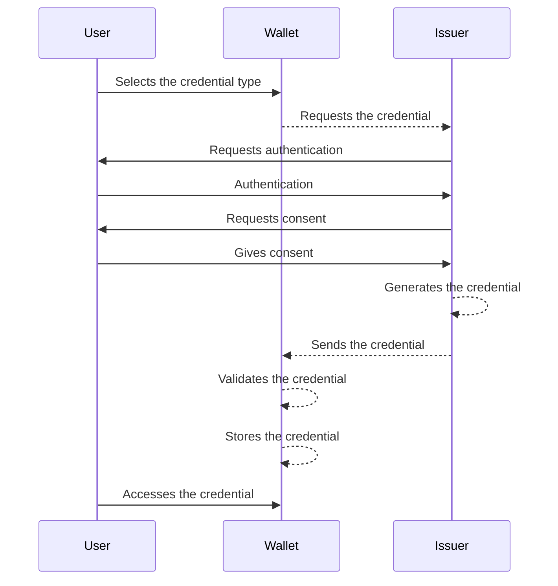
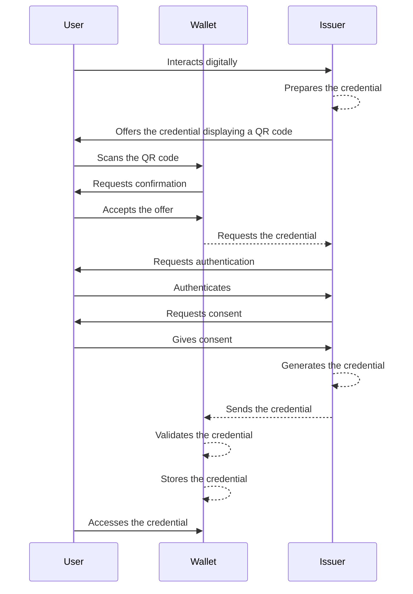

# How the Wallet Interacts with Services
Chapter 3 introduced the main actors in the WE BUILD ecosystem. This chapter describes how these actors interact through wallet-based service flows.

## Interaction Pattern: Attestation Issuance

The [WBCS](https://github.com/webuild-consortium/wp4-architecture/blob/blueprint/updates-jan/conformance-specs/cs-01-credential-issuance.md) for high-assurance credential issuance defines the requirements used in the project to ensure interoperable issuance of verifiable digital credentials between wallets and issuers. For reference on qualified electronic attestation of attributes, see the [QEAA documentation](#qeaa-documentation).

The WE BUILD ecosystem mainly supports two credential issuance models, which differ in which actor initiates the process: wallet-initiated issuance and issuer-initiated issuance. If the credential cannot be issued immediately, deferred issuance is used. The wallet retries periodically until the credential is issued or an unrecoverable error occurs.

### Wallet-initiated Issuance

This issuance flow is initiated by the user:

1. The user opens their wallet and selects the credential type to be issued (for example, a PID or a QEAA).
2. The wallet connects with the corresponding issuer and requests the credential.
3. The user authenticates with the issuer, following the procedure specified by the issuer itself.
4. The issuer requests the user's consent to issue the credential and send it to their wallet.
5. The issuer generates the credential and delivers it to the wallet.
6. The wallet verifies the authenticity of the credential and stores it. From this point, the user becomes responsible for managing the issued credential.

### Issuer-initiated Issuance

This issuance flow is initiated by the issuer:

1. The user interacts with the issuer (for example, during a digital onboarding process).
2. The issuer prepares one or more credentials.
3. The issuer offers these credentials to the user. This can be done in several ways, both same-device and cross-device:
- By displaying a QR code that the user shall scan with their wallet.
- By sending a link to the wallet.
4. The wallet displays the offer and requests confirmation from the user.
5. The user authenticates with the issuer, following the procedure specified by the issuer itself.
6. The issuer requests the user's consent to issue the credential and send it to their wallet.
7. The issuer generates the credential and delivers it to the wallet.
8. The wallet verifies the authenticity of the credential and stores it. From this point, the user becomes responsible for managing the issued credential.

## Interaction Pattern: Attestation Presentation (Receiving) 

In this pattern, a verifier requests specific attestations from the wallet. The wallet presents the requested information, typically using selective disclosure mechanisms, and the verifier validates the received data.

The [WE BUILD Conformance Specification for Credential Presentation](https://github.com/webuild-consortium/wp4-architecture/blob/blueprint/updates-jan/conformance-specs/cs-02-credential-presentation.md) describes how wallets and relying parties interoperate within the WE BUILD ecosystem. It covers presentation (request and response flows), interfaces between wallets and relying parties as well as security, privacy and interoperability requirements and same‑device and cross‑device invocation patterns.

Authorisation and Mandate Management

European Business Wallets need to support different forms of authorisation so that organisations can determine who may access the wallet, operate its functions and interact with services. For interoperability and legal certainty, wallet-level authorisation, organisation-issued internal authorisation should be distinguished from legal representation towards third parties.
The Council General Approach ST 7659/26 reflects this distinction. Recital 18 states that EBW authorisations are technical in nature and do not create, limit or otherwise affect powers of attorney or legal mandates under applicable national or Union law. Article 5(1)(j) similarly provides for multiple users to access and operate an EBW without prejudice to any power of attorney or legal mandate.

Three conceptual layers

•	Layer 1 - Relationship with the organisation
An attestation may establish that a natural person has a relationship with an organisation, for example as an employee, contractor, service provider or other associated person. Proof of Employment (PoE) belongs to this layer. The existence of such a relationship does not automatically confer authority to act on behalf of the organisation.
•	Layer 2 - Operational or service authorisation
The organisation may authorise a natural person, legal person or system to perform specified operations or access specific resources. Such permission may be represented through the organisation's IAM/IGA infrastructure or documented as an organisation-issued internal authorisation. An internal authorisation should not automatically be treated as an EAA unless it is issued in accordance with the applicable eIDAS framework for electronic attestation of attributes services.
•	Layer 3 - Legal representation
Where an operation is intended to legally bind the organisation towards third parties, the requirements of applicable Union and national law on legal representation must also be satisfied. The authority may derive from statutory representation (PoR), a power of attorney (PoA), a business register, a Digital EU Power of Attorney, notariat or another legally recognised source or instrument. Where applicable law requires an authentic form, public document, notarial intervention or another specific safeguard, the EBW authorisation mechanism does not replace that requirement.

Common Authorisation Attestation model

WE BUILD should aim at a common, minimal and legally neutral Authorisation Attestation model rather than separate and potentially incompatible models for each legal situation. At semantic level, the basic relationship can be expressed as Subject -> Authorisation -> Organisation.
The common model should support, at minimum:
•	subject of the authorisation;
•	organisation;
•	issuer;
•	scope;
•	validity period;
•	attestation identifier.
Where relevant to a legal or operational use case, the model should also support the source of authority, applicable jurisdiction, issuer role and competence and references to authoritative evidence or an authentic source.
Legal basis: Article 3(43) eIDAS defines an attribute as including a right or permission. Annex VI includes powers and mandates to represent natural or legal persons among the attributes for which electronic verification against relevant public-sector authentic sources must be enabled where those attributes rely on such sources. Article 14(d)(i) of Directive (EU) 2017/1132 requires disclosure of whether persons authorised to represent a company may act alone or jointly.

Scope and service-based authorisation

Where possible, the scope of an Authorisation Attestation should be structured and machine-processable. A service-based authorisation may define the permitted action by reference to a service offered by a relying party, for example: Organisation A -> Person X -> Service Y -> Permitted Action Z -> Valid until T.
A service-based authorisation does not become a legal power of representation merely because its scope is technically defined or machine-processable.
Where the service includes an act capable of legally binding the organisation, the relying party must also determine whether applicable law requires PoR, PoA or another legally recognised form of representation.

Organisation-self-issued Authorisation Attestations

Organisation-self-issued Authorisation Attestations may be particularly suitable for employee permissions, internal access, operational permissions, service-based authorisations, document access, system-to-system interactions and enterprise API access. They may be documented in electronically signed or sealed form and, where appropriate, transmitted through QERDS.
An organisation-issued internal authorisation should not automatically be labelled an EAA. Recital 55 of Regulation (EU) 2024/1183 states that any service provider issuing attested attributes in electronic form, including powers and mandates, should be considered a trust service provider of electronic attestation of attributes. Article 3(45) eIDAS defines a QEAA as an EAA issued by a qualified trust service provider. Therefore, an organisation acting merely as EBW owner should not be assumed to issue an EAA unless the applicable eIDAS requirements for the corresponding trust service are satisfied.
A relying party should be able to verify the organisation, issuer, subject, scope, validity, revocation status and applicable restrictions. However, proof that the organisation issued the attestation is not necessarily proof that the subject holds a legally sufficient power of representation for every transaction.
Where the attestation is protected by a qualified electronic seal, Article 35(2) eIDAS provides a presumption of integrity of the data and correctness of their origin. That presumption concerns origin and integrity; it does not, by itself, establish the legal existence, validity or sufficiency of a power of representation where applicable law requires additional safeguards.

QTSP-issued Authorisation Attestations

A QTSP may issue qualified electronic attestations of attributes under eIDAS. The qualified status and technical assurance of the attestation must nevertheless be distinguished from the legal source of the authority being attested.
Article 45b(2) eIDAS gives a qualified electronic attestation of attributes, and an attestation issued by or on behalf of a public sector body responsible for an authentic source, the same legal effect as lawfully issued attestations in paper form. This does not transfer to a QTSP, merely by virtue of its status, the legal competence to create an underlying power of representation.
Where the attestation concerns legal representation, the QTSP must have a legally sufficient basis for attesting its existence and scope. Commission Implementing Regulation (EU) 2025/1569, Article 8(3)(d), (g) and (h), requires attestation schemes to identify relevant laws, the trust model and requirements concerning the information sources on which providers rely, including authentic sources where applicable. Article 9 establishes mechanisms for verification against authentic sources or designated intermediaries for the attributes covered by Article 45e(1) eIDAS.

Legal representation and authentic sources 

For legal representation, the Authorisation Attestation should be capable of referring to, or being derived from, the legally relevant evidence underlying the authority.
For PoR, evidence may derive, where applicable, from the business register, an EU Company Certificate or another legally recognised authoritative source. Directive (EU) 2017/1132 requires disclosure of the persons authorised to represent the company and whether they may act alone or jointly.
For PoA, the digital representation of the power should be distinguished from the legal creation of the power. Article 16c of Directive (EU) 2025/25 requires the Digital EU Power of Attorney to be drawn up, amended or revoked in accordance with national requirements, including at minimum verification by courts, notaries or other competent authorities of the identity, legal capacity and authority to represent the company of the person granting, amending or revoking the power. Recital 28 preserves national rules on legal and statutory representation and other powers of attorney. Separately, notarial intervention may establish or verify the authoritative legal evidence underlying a power of representation.
Under Article 3(47) eIDAS, an authentic source is a repository or system held under the responsibility of a public sector body or private entity that contains and provides attributes and is considered a primary source or recognised as authentic under Union or national law, including administrative practice. Where recognised under applicable national law, a repository or information system held under the responsibility of the notariat may therefore constitute an authentic source.
The model should accommodate different national legal traditions without requiring harmonisation of national representation systems. Depending on national law, the relevant evidence may derive from a business register, a notarial system, a court or another competent authority or authentic source.
Digitalisation of a power of representation does not imply removal of the legal controls governing its creation, validity or scope.

Binding the authorisation to the natural person

The system should ensure that the person using an authorisation is the person to whom it was granted. This supports security, traceability, auditability and liability. The approach should be consistent with the organisational signing model in this chapter, which binds the natural person through PID and the organisation through EBWOID.

Current legal framework

Operational authorisations may be implemented as Organisation -> self-issued Authorisation Attestation -> Person/System -> Service where the organisation is free to define the relevant permission internally. Legal representation should follow Legal/Authentic Source -> PoR or PoA -> Authorisation Attestation -> Wallet -> Relying Party. Where national law requires a register, notarial intervention, public document or other safeguard, that requirement remains applicable. The attestation provides a digital and interoperable evidence layer rather than replacing the legal source of authority.

Key principle

The European Business Wallet should digitalise the exercise and proof of authority, but should not redefine the legal source from which that authority derives. Wallet-level and administrative authorisations may be managed within the organisation and through the European Business Wallet, whereas powers of legal representation remain governed by applicable Union and national law. Where applicable law requires authoritative evidence, preventive legal control or a specific legal form, the Authorisation Attestation model should integrate those requirements into a digitally verifiable and interoperable flow rather than replace them.

## Signature and Seal Integration

Wallets in WE BUILD provide the ability to create qualified electronic signatures and seals. This section describes the various integration models. For reference, see the [QES documentation](https://github.com/webuild-consortium/wp4-qtsp-group/tree/main/docs/qes).

WE BUILD supports both wallet-centric and QTSP-operated approaches for electronic signatures and seals. In both models, the wallet provides the user interaction layer, while cryptographic operations may take place either locally or in remote infrastructure operated by a QTSP.

Both approaches are compatible with the architectural patterns described in the ARF. However, during the WE BUILD pilot phase not every wallet provider or QTSP is expected to implement every possible model. For interoperability across the consortium, WE BUILD therefore treats remote signing and sealing through QTSP-managed services with standardised interfaces as the common baseline. Local signing models may still be supported by individual wallet implementations, but they are not assumed as a uniform baseline for interoperability within the project.

This section aligns with the WP4 interoperability baselines defined for issuance and presentation flows. Proximity-based signing scenarios are currently outside the baseline protocol scope of the WE BUILD pilots.

In the WE BUILD pilot and ITB environment, eIDAS-qualified status cannot be achieved because the ITB operates outside the formal eIDAS certification framework. Any reference to “qualified” in WE BUILD therefore represents a technical demonstration only and does not constitute a legally valid qualified electronic signature. The prerequisites for eIDAS-qualified status remain unchanged, including use of a Qualified Signature Creation Device (QSCD) and a qualified certificate issued by a QTSP that is listed on an official national Trusted List.

### Wallet-centric Signing Model
In the wallet-centric model, the EUDI Wallet is the central component of the electronic signature process. Three distinct signing processes are considered, depending on where the Signature Creation Application (SCA) runs and where the Signature Creation Device (SCD) is hosted. 

#### 1) Remote Signing with External SCA  
The user initiates signing from the wallet, while the SCA is external. The document is sent to the external SCA for review and consent, after which the signing request is forwarded to a remote SCD that creates the signature and returns the result.

#### Remote Signing with Local SCA (Wallet as SCA)
The user initiates signing from the wallet, which also acts as the SCA. The document is presented to the user within the wallet for review and consent. After approval, the wallet forwards the signing request to a remote SCD that produces the signature and returns the result.

#### 3) Local Signing  
The user initiates signing from the wallet, which also acts as the SCA. The document is presented to the user within the wallet for review and consent. After approval, the signature is created locally using a SCD integrated in the user’s device.

### QTSP-centric Signing and Sealing Model
In the QTSP-centric model, the trust service provider operates the signing or sealing process. The cryptographic key material used for signature or seal creation is generated, stored, and used within infrastructure controlled by or on behalf of the QTSP, typically in secure hardware environments. From the perspective of the user, signing and sealing are therefore remote operations. External components interact with the trust service through defined interfaces, while the cryptographic operation itself is performed within the QTSP-controlled environment.

Within this architecture, the EUDI Wallet may act as a client-side orchestration component. It can authenticate the user, capture user intent, and trigger a signing operation. However, it does not operate the signature creation environment, does not manage signing credentials, and does not assume the responsibilities of a trust service provider.

In this model, the QTSP remains responsible for identity binding, credential issuance, and compliance with applicable ETSI standards. Signature or seal creation data remains under controlled conditions consistent with the required assurance level, and activation mechanisms enforce the conditions required for advanced or qualified signatures, including sole control where applicable.

The pilot implementation aims to remain technically aligned with qualified signing requirements. Pilot trust validation is described below and relies on consortium trusted lists.

### CSC Interoperability Profile for Remote Signing and Sealing
For remote signing and sealing flows, WE BUILD uses the Cloud Signature Consortium (CSC) interoperability framework. CSC APIs expose standardised interfaces that allow wallets and client applications to interact with QTSP-operated signing services.
The detailed WE BUILD CSC interoperability profile will be defined in a WBCS. That specification will describe the concrete integration details, including authorisation mechanisms, endpoints, supported formats and algorithms, and interoperability constraints used in the ITB. Until such a profile is published, CSC API v2.2.0.0 serves as the base reference specification for CSC-based interactions.

During the pilot phase, trust validation relies on consortium reference trust mechanisms. Wallet components or external SCAs validate participating QTSPs and trust anchors using WE BUILD trusted lists. The reference trusted list may include participating QTSP entries and their registered issuing certificate authorities for pilot purposes.

When a signing request is processed, the SCA validates the signer’s certificate chain against issuing certificate authorities listed in the WE BUILD trusted list and checks the QTSP status within the pilot trust framework. Revocation status is validated using OCSP responders or CRL distribution points operated by participating QTSPs. Where registration status checks are required, registrar processes are simulated through mock registrar services and endpoints.

### Organisational Signing: Individuals Signing on Behalf of a Company
WE BUILD supports signing scenarios where an individual signs on behalf of an organisation. This model reuses the wallet-centric and QTSP-operated signing approaches described above. The wallet provides the user interface for document review and approval, while the QTSP performs the signature or seal creation within its controlled environment. 

In these scenarios, the transaction must bind both the natural person and the organisation represented. The natural person identity is represented by the PID, while the organisation context is represented through the EBWOID, which acts as the cross-border minimum organisation identifier.

At signing time, identifiers or references to both the PID and the EBWOID are included in the transaction data presented to the user and subsequently authorised or signed. This ensures that the resulting signature or seal can be unambiguously linked to both the individual and the organisation.

The exact representation of these bindings is use-case specific and will be defined in rulebooks and WBCS (see Chapter 5 for the semantic and schema model).

## Secure Communication Channel
This section describes how secure message exchange is integrated into the WE BUILD wallet ecosystem.

In WE BUILD, the secure communication channel is implemented through Qualified Electronic Registered Delivery Services (QERDS) operated by QTSPs. Whenever legal-grade delivery assurance is required, messages are routed through QERDS. QERDS providers ensure mutual authentication, end-to-end integrity and confidentiality, and interoperability across access points. This “registered delivery” pattern is positioned as an enabler for interactions between and across public sector bodies and economic operators.

Because the QERDS and the EU Digital Directory designated for the production European Business Wallet are not yet available, WE BUILD designates the pre-production QERDS specified by WP4 for use in WE BUILD business wallets.
For reference, see the [QERDS documentation](#qerds-documentation).

### From “Registered Delivery” to “Digital Identity Wallets”
As a baseline, a classic B2G/B2B situation is used: an authority notifies an economic operator, the economic operator responds, and the relying party requires evidence. With QERDS, both sides use their QERDS providers to register sending and receiving, so that delivery is not just transport, but is a process that produces trustworthy evidence.

In this model, WE BUILD takes the next step: wallets become the user-facing endpoints (“wallet-centric delivery”). The sender wallet and recipient wallet remain the places where users read, approve, and manage messages, or where they configure connections to backend systems to perform these actions. QERDS providers form the delivery layer underneath, handling routing, inter-provider exchange, and evidence creation, while wallets provide identity/authentication and user control.

### Technical Flow (WE BUILD High-Level)
WE BUILD follows the QERDS architecture decomposition and the four-corner delivery pattern:

1. Sender identification and authentication is performed at the sender’s QTSP (wallet-driven).
2. Message submission is performed from the sender’s wallet or connected backend system to the sender QERDS (QTSP A).
3. Discovery of the recipient’s QERDS endpoint and capabilities is performed via common services (e.g., the WE BUILD Digital Directory, simulating the EU Digital Directory from the EBW proposal).
4. Handshake and relay is performed between QTSP A and QTSP B (QERDS-to-QERDS interoperability).
5. Recipient notification is issued, followed by recipient authentication at QTSP B.
6. Consignment and handover of the message and its metadata is performed to the recipient’s wallet or connected backend system.
7. Evidence is made available to sender and recipient wallets (submission/dispatch and receipt/consignment or non-delivery). Evidence is protected by qualified sealing and, where required, qualified timestamping. Where applicable, the evidence can be pushed to the sender’s and the recipient’s backend systems as well.

## Enterprise and System-to-System Wallet Interactions
Some WE BUILD scenarios involve interactions between backend systems rather than direct end-user actions. In these cases, wallet functionality may be integrated into enterprise platforms, APIs, or automated services.

This is particularly relevant for EBW scenarios such as supply chain credentials, Digital Product Passports, and automated B2B or B2G data exchange. In such cases, credential issuance and presentation may be initiated by backend systems while still following the interoperability patterns defined in this blueprint.

Although the interaction is system-driven, the same trust framework, credential formats, and verification mechanisms apply as in user-driven wallet interactions.
